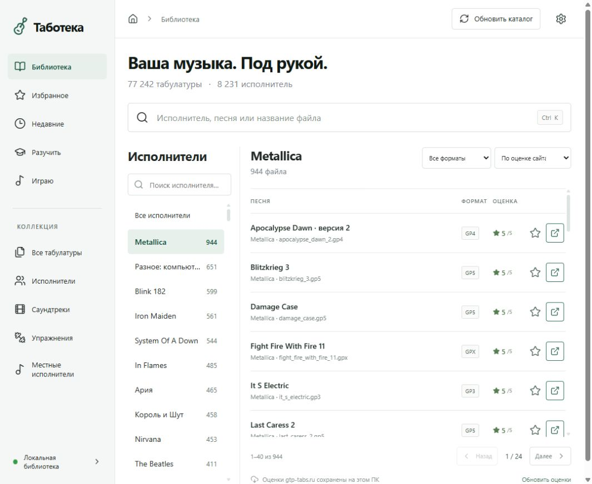
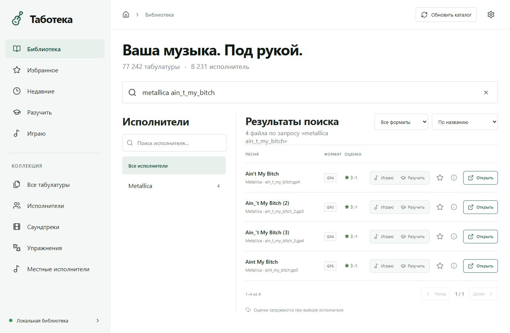
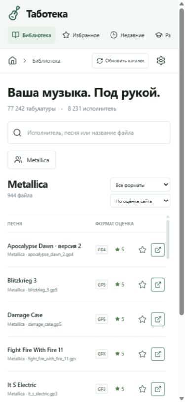

# Таботека

**Локальная библиотека гитарных табулатур: исполнитель → песня → Guitar Pro.**

Таботека превращает большой архив Guitar Pro в удобный сайт на вашем Windows-ПК. Она индексирует существующие папки, показывает все версии песен, помогает найти нужную аранжировку, сохраняет избранное и открывает исходный файл в настольной Guitar Pro. Перекладывать или переименовывать архив не требуется.

Проект появился из практической задачи: пользоваться архивом из **77 242 файлов и 8 231 папки исполнителей**, скачанным с [gtp-tabs.ru](https://www.gtp-tabs.ru/), когда навигация по исходному сайту была неудобна. В репозитории опубликовано приложение; сам музыкальный архив нужно предоставить отдельно.



## Что умеет

- Поиск по исполнителю, песне и имени файла, включая поиск русских имён через транслитерацию. Сочетание `Ctrl+K` переводит фокус в поиск.
- Каталог исполнителей, категории архива, фильтр формата, сортировка по названию, оценке, размеру и недавним открытиям.
- Все варианты аранжировки отдельными строками. Файлы разных версий не объединяются.
- Настоящие отображаемые названия по страницам источника и согласующимся заголовкам Guitar Pro. Поиск учитывает и уточнённое название, и прежнюю транслитерацию; происхождение названия видно в карточке файла.
- Избранное, списки «Разучить» и «Играю», заметки и история открытий. Кнопки списков находятся прямо в строке песни: повторное нажатие снимает отметку, выбор другого списка переносит туда файл. Выбранный список подсвечен, количество файлов видно в меню. Заметки и сведения доступны по значку ⓘ в группе действий. На широком экране действия выровнены справа, на узком переходят на отдельную линию под названием.
- Открытие табулатуры в уже запущенной Guitar Pro или запуск программы с выбранным файлом через штатную ассоциацию Windows.
- Получение доступных звёздных оценок с gtp-tabs.ru, локальный кеш, обновление исполнителя и фоновая загрузка всей библиотеки с продолжением после перезапуска.
- Экспорт и импорт личных данных в JSON. Табулатуры в резервную копию не входят.
- Адаптивный интерфейс, клавиатурное управление диалогами и понятные сообщения об ошибках.

<details>
<summary>Добавление песни в списки занятий без открытия карточки</summary>



</details>

<details>
<summary>Вид при узкой ширине экрана</summary>



Это пример адаптивной компоновки. Приложение по умолчанию доступно только на том ПК, где установлено; открытие Guitar Pro также выполняется на этом ПК.

</details>

## Как это устроено

| Часть | Реализация | Назначение |
| --- | --- | --- |
| Интерфейс | React 19, Vite 7, Lucide | Поиск, каталог, списки и настройки |
| Локальный API | Python 3.13, стандартная библиотека | Индексация, безопасное открытие файлов, импорт оценок |
| Хранилище | SQLite в режиме WAL | Метаданные, избранное, заметки, оценки |
| Основной веб-сервер | Windows IIS | Раздаёт только собранный `dist/` |
| Настольная интеграция | Интерактивная задача Windows | API работает от пользователя и открывает Guitar Pro в его сеансе |

По умолчанию IIS слушает `http://127.0.0.1:8765`, а API — `http://127.0.0.1:8766`. Прокси IIS, PHP, ASP.NET, Node-сервер и отдельная СУБД не нужны. Node.js нужен для сборки интерфейса. Для Python нет внешних pip-зависимостей.

Исходный архив читается при сканировании. Приложение не переименовывает, не перемещает и не перезаписывает табулатуры. Работа в самой Guitar Pro и сохранение отредактированной партитуры уже зависят от действий пользователя.

## Требования

- Windows 10/11, Python 3.13 с `python.exe` и `pythonw.exe`.
- Node.js 24 и pnpm 11.25.0 для воспроизводимой сборки.
- Guitar Pro и настроенные файловые ассоциации для нужных форматов.
- IIS с компонентами Static Content и Default Document для основного способа установки. Для пробного запуска IIS необязателен.
- Ваш архив в структуре, описанной ниже. Интернет нужен для установки пакетов и обновления оценок; уже проиндексированная библиотека и сохранённые оценки доступны без него.

## Установка на Windows с IIS

Клонируйте проект в постоянную папку с правом записи для вашего пользователя. Команды ниже выполняются из корня проекта в PowerShell.

```powershell
git clone https://github.com/sergeysrnd/taboteka.git
cd taboteka
python --version
node --version
npm install --global pnpm@11.25.0
```

Создайте локальную конфигурацию. Укажите существующую папку архива; приведённые пути — примеры.

```powershell
python configure.py --tabs-root "D:\GuitarTabs" --guitar-pro "C:\Program Files\Arobas Music\Guitar Pro 8\GuitarPro.exe"
pnpm install --frozen-lockfile
pnpm build
```

`--guitar-pro` можно опустить, если Guitar Pro 8 установлена в стандартной папке: настройщик попробует найти её автоматически. Иначе укажите путь или сохраните его позже в настройках сайта. Настройщик создаёт игнорируемые Git файлы `config.json`, `.env.local` и `data/python-path.txt`. Чтобы заменить существующую конфигурацию, используйте `--force`. Другие порты задаются через `--site-port` и `--api-port`; после смены API-порта повторите сборку.

Откройте **PowerShell от имени администратора под тем же пользователем Windows**, перейдите в папку проекта и выполните:

```powershell
powershell -ExecutionPolicy Bypass -File .\setup-iis.ps1
```

Скрипт создаёт сайт и пул `Taboteka`, привязку только к `127.0.0.1`, выдаёт пулу право чтения только `dist/`, регистрирует задачу `Taboteka API` при входе пользователя и проверяет запуск API. Уже существующие чужие сайты, задачи и общие пулы с совпадающими именами вызывают остановку с сообщением. Снимок конфигурации IIS и журнал установки сохраняются локально в `data/`.

Если заданы другие порты или Python не найден:

```powershell
powershell -ExecutionPolicy Bypass -File .\setup-iis.ps1 -Port 8875 -PythonPath "C:\Python313\python.exe"
```

Откройте **http://127.0.0.1:8765/**. При первом старте API построит каталог; большой архив может сканироваться несколько минут. В дальнейшем после добавления или удаления файлов нажимайте «Обновить каталог».

Для открытия сайта можно запускать `pythonw launch.pyw` или сделать Windows-ярлык на эту команду с рабочей папкой проекта. Не переносите установленную папку без повторной настройки IIS и задачи.

### Быстрый запуск без IIS

После настройки и сборки запустите:

```powershell
python server.py
```

Откройте **http://127.0.0.1:8766/**. API умеет раздавать тот же `dist/`. Терминал должен оставаться открытым; завершение — `Ctrl+C`. Не запускайте второй API, если уже работает задача `Taboteka API`.

## Формат архива

Поддерживаются `.gp`, `.gp3`, `.gp4`, `.gp5`, `.gpx`, `.gtp`, регистр расширения не важен. Каталог ориентирован на структуру архива gtp-tabs.ru:

```text
GuitarTabs/
  13/
    metallica/
      nothing_else_matters.gp4
      nothing_else_matters_2.gp5
  37/
    kino/
      gruppa_krovi.gp4
```

Первые два уровня задают группу и исполнителя. Группы `1–26` относятся к латинскому алфавиту, `27` — к цифрам, `28–53` — к русскому разделу, `54` — к саундтрекам, `55` — к местным исполнителям, `56` — к упражнениям. Имя папки исполнителя используется как slug источника. Вложенные папки внутри исполнителя допустимы. Файлы непосредственно в корне или без этих двух уровней пропускаются. Символические ссылки и Windows junctions не обходятся.

Начальный каталог строится по именам папок и файлов. Отдельный обработчик добавляет отображаемые названия из источника и ограниченного заголовка GP3/4/5; ноты, дорожки и аранжировки не анализируются. Для иной структуры потребуется изменить индексатор или подготовить отдельное представление архива. Права на ваши файлы определяются их правообладателями.

## Восстановление настоящих названий

`catalog_names.py` сохраняет уточнённые имена в отдельных полях SQLite. Исходные `path`, `filename`, ID, избранное и заметки остаются прежними. Поиск работает одновременно по оригинальному имени и новому названию. Повторное сканирование сохраняет названия неизменённых файлов; замена файла сбрасывает старое соответствие.

Имена исполнителей берутся из алфавитных списков gtp-tabs.ru с точной привязкой к адресу каталога. Для нескольких проверенных переездов и старых опечаток есть явная таблица соответствий. Названия песен принимаются при совпадении исполнителя, полного slug версии и размера файла. Если страница каталога не работает, можно подтвердить отдельную страницу композиции. В остальных случаях читаются только первые поля заголовка GP3/4/5: заголовок принимается при согласовании с именем файла по ограниченным вариантам транслитерации. В русском разделе используется CP1251, в остальных — CP1252; UTF-8 проверяется первым.

Названия зарубежных песен сохраняются на языке источника. Слова `cover`, `intro`, `solo`, обозначения аранжировок и номера версий не отбрасываются ради совпадения. Простое наследование названия от файла без суффикса `_2` не считается подтверждением и оставляется на проверку.

```powershell
# Сначала план без изменения названий в базе:
python catalog_names.py --fetch-indexes russian --scope russian --headers
# После проверки плана — обработка всей библиотеки:
python catalog_names.py --fetch-indexes all --scope all --headers --apply
```

Планы, кандидаты и снимки списков сохраняются локально в `data/names/`. Перед массовой обработкой сделайте резервную копию базы и временно остановите массовую загрузку оценок через настройки, чтобы два процесса не обращались к источнику одновременно. Без `--apply` команда не записывает отображаемые названия. Последующие успешные обновления оценок автоматически уточняют и названия подтверждённых файлов.

Кандидаты и неподтверждённые записи сохраняют прежнее отображение. Отсутствие нового названия не означает отсутствие файла. Методика контрольной выборки и результат первого полного прохода описаны в [проверке названий](docs/NAME_MATCHING.md).

## Оценки с gtp-tabs.ru

При выборе исполнителя приложение запрашивает страницу списка его бесплатных табулатур. В настройках можно запустить обновление всей библиотеки, увидеть прогресс или остановить его. Оно не скачивает музыкальные файлы.

Соответствие определяется по точному имени файла в адресе источника, включая суффикс версии, и размеру с учётом округления на сайте. Неоднозначные совпадения пропускаются. Показывается число заполненных звёзд из доступной HTML-разметки, а не выдуманная оценка или вычисленный средний балл. Пустая оценка означает отсутствие подтверждённых звёзд; наличие совпадения само по себе ещё не означает наличие оценки.

Запросы начинаются с интервалом не менее 0,8 секунды; для временных сетевых ошибок предусмотрены ограниченные повторы. Успешный кеш действует семь дней, повтор после ошибки при выборе исполнителя возможен через десять минут. Принудительное обновление обходит срок кеша. Массовый запуск обрабатывает устаревших или ещё не загруженных исполнителей.

Неполный ответ сайта не удаляет ранее подтверждённые оценки для отсутствующих в ответе файлов. Поэтому часть оценок может оставаться старой. Замена локального файла, обнаруженная по размеру или времени изменения, сбрасывает его прежнее соответствие. Изменение HTML источника может потребовать обновления парсера.

## Личные данные и резервные копии

Все данные находятся локально в `data/`. Через настройки экспортируйте JSON с избранным, списками, заметками и историей. Импорт сопоставляет записи по относительному пути, обновляет совпавшие записи и оставляет остальные без изменений. Для восстановления сначала проиндексируйте тот же архив. При переименовании файла связь с прежней записью не переносится автоматически.

Полную копию `data/` и `config.json` делайте при остановленном API; не копируйте только открытый файл SQLite, игнорируя его WAL. В экспорт не входят сами табулатуры и кеш оценок.

В Git исключены архивы Guitar Pro, база, кеш источника, журналы, личная конфигурация, `.env`, ярлыки и сборка. Дополнительная проверка просматривает **Git index**, поэтому замечает даже принудительно добавленные игнорируемые файлы:

```powershell
python scripts/check_publication.py
```

## Обновление и разработка

Сохраните личные данные, получите обновления, установите зависимости и соберите интерфейс:

```powershell
git pull --ff-only
pnpm install --frozen-lockfile
pnpm build
python -m unittest discover -s tests -v
```

Затем в административном PowerShell повторите `setup-iis.ps1 -RestartApi` для перезапуска пользовательской задачи. Незавершённая массовая загрузка оценок продолжится по локальному маркеру. Миграции SQLite применяются при запуске; личные записи сохраняются.

Для разработки интерфейса запустите API и `pnpm dev`. Vite использует порт сайта из конфигурации и прекращает запуск, если он занят. Если установлен IIS, временно остановите **только сайт Taboteka** в диспетчере IIS, чтобы освободить его порт; по завершении снова запустите сайт. Не меняйте адрес на общедоступный: модель доступа рассчитана на loopback и одного пользователя.

Тесты создают временную библиотеку и базу, подменяют сетевые ответы и вызов Guitar Pro. Они не читают личный архив, не обращаются к gtp-tabs.ru и не открывают партитуры. GitHub Actions запускает их на Windows и Ubuntu, собирает интерфейс и проверяет состав репозитория и зависимости. Нативный Windows/DDE-сценарий проверяется отдельно вручную.

## Если что-то не работает

| Симптом | Что проверить |
| --- | --- |
| Сайт открыт, библиотека недоступна | Работает ли задача `Taboteka API`, доступен ли `/api/stats` на API-порту, верны ли пути в `config.json` |
| IIS отвечает 403/404/500 | Включены ли Static Content и Default Document; выполнены ли сборка и `setup-iis.ps1`; журнал `data/iis-setup.log` |
| Guitar Pro запускается без файла | Через Windows «Открыть с помощью» назначьте нужную Guitar Pro для конкретного расширения; путь должен совпадать с настройками сайта |
| Другая программа назначена для GP4/GP5 | Приложение покажет ошибку; исправьте ассоциацию Windows и повторите открытие |
| Нет части оценок | У источника нет звёзд, изменился размер/имя, страница недоступна или совпадение неоднозначно; пустые оценки не равны нулю |
| Архив временно недоступен в OneDrive | Дождитесь доступности файлов и повторите сканирование; при ошибке обхода старый индекс сохраняется |
| Ошибка порта или второго API | Остановите ручной экземпляр `server.py` либо проверьте задачу; не завершайте неизвестный процесс только по номеру порта |

## Ограничения и лицензия

Приложение предназначено для одного пользователя на локальном ПК. API открывает файлы в интерактивном сеансе Windows, поэтому задача работает после входа пользователя. Публичный интернет-хостинг, общий сервер, доступ с телефона по LAN и многопользовательская авторизация не реализованы. Проверка пути и расширения не проверяет корректность содержимого музыкального файла; его разбирает Guitar Pro.

Код опубликован под [MIT](LICENSE). Guitar Pro — отдельный продукт Arobas Music. Таботека не связана с Arobas Music или gtp-tabs.ru. Лицензия приложения не распространяется на сторонние табулатуры, записи сайта и зависимости; их права и лицензии сохраняются.

Подробности проверки кода и исправлений: [отчёт ревью](docs/CODE_REVIEW.md). Описание файлов и границ системы: [архитектура](docs/ARCHITECTURE.md).
