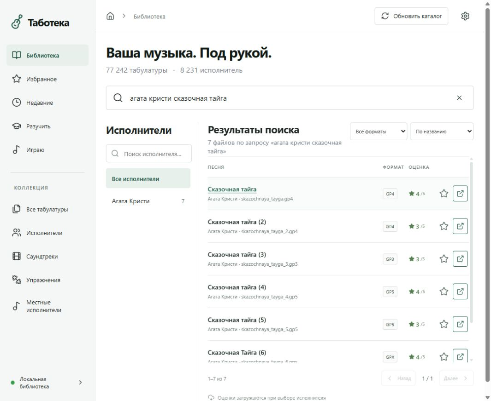

# Проверка отображаемых названий

Обработка изменяет только метаданные SQLite. Файлы архива не переименовываются и не сохраняются. Начальные названия, относительные пути и поисковые токены остаются доступными.

## Основания для принятия

| Метод | Проверки | Что видит пользователь |
| --- | --- | --- |
| `artist_index` | Совпадение адреса исполнителя в алфавитном каталоге | Имя, опубликованное источником |
| `artist_alias` | Явно проверенный прежний адрес → нынешний адрес | Имя после переноса каталога или исправления старого slug |
| `source_exact` | Тот же исполнитель, точный slug версии, размер с округлением источника | Заголовок конкретной страницы/строки источника и ссылка |
| `file_header` | Ограниченное чтение первых трёх строк GP3/4/5; заголовок согласуется с именем файла | Название из метаданных Guitar Pro с явной пометкой |

Размер и время изменения проверяются повторно при применении плана. Устаревший план не обновляет файл, который успели заменить и пересканировать. Более слабый заголовок файла не перезаписывает название, подтверждённое источником. Личные поля не участвуют в обновлении.

## Контрольная выборка

Первый этап ограничен русским алфавитным разделом архива: 647 папок исполнителей и 7 028 файлов. Это категория исходного архива; она включает также украинские композиции и отдельных зарубежных авторов.

Детерминированная выборка состоит из 300 файлов у 270 исполнителей: 220 совпадений из кеша источника, 40 заголовков файлов и 40 потенциальных числовых вариантов. Выборка разнесена по исполнителям, а не набрана из одной популярной группы. Это 300 файлов аранжировок; разные версии одной песни не объявляются уникальными музыкальными произведениями.

Для первых 220 заново загружены страницы исполнителей и проверены название, точная версия и размер. Для остальных 80 дополнительно проверены самостоятельные страницы композиций с основным заголовком и размером; размер из списка «Другие табулатуры» не принимается. Для всех 300 сравнивались SHA-256 файлов до и после проверки.

Результат: **299 из 300 подтверждены независимым повторным запросом к источнику**. Один случай остался без подтверждения из-за HTTP 404 и удержан от автоматического применения. Изменений контрольных сумм нет. Это доля подтверждений в выборке, а не заявленная точность всей библиотеки.

При анализе кандидатов обнаружен риск: числовой суффикс может быть частью названия отдельного произведения. Поэтому наследование имени по одному `_2` исключено из автоматического применения. Проверенные самостоятельные страницы таких файлов дают название именно этой версии и могут приниматься как `source_exact`.

Полный протокол с относительными путями и источниками хранится локально в `data/names/pilot-300-final.json`. В репозиторий личный каталог, снимки архива и музыкальные файлы не публикуются.

## Первый полный проход

После проверки выборки обработаны **все 77 242 файла и 8 231 папка исполнителей**. Добавлены отображаемые названия для **72 903 файлов (94,4%)** и имена для **8 189 исполнителей**. Для 67 517 файлов основание — точное совпадение с источником, для 5 386 — согласующийся заголовок локального файла. Оставшиеся 4 339 файлов и 42 исполнителя сохранили исходное отображение; часть из них имеет кандидатов, часть не содержит достаточных метаданных.

| Раздел архива | Файлов | С уточнённым названием |
| --- | ---: | ---: |
| Русский алфавит | 7 028 | 6 032 |
| Международный | 66 254 | 63 758 |
| Саундтреки | 1 659 | 1 290 |
| Местные исполнители | 1 268 | 835 |
| Упражнения | 1 033 | 988 |

В русском разделе уточнены имена 645 из 647 исполнителей. Найдены и явно сопоставлены переезды Александра Виницкого и Валентина Стрыкало, историческая опечатка в slug Александра Розенбаума и прежний каталог народных песен.

Затем дополнительно проверены 200 неподтверждённых файлов популярных исполнителей по самостоятельным страницам: 194 получили подтверждение заголовка и размера. Итог этого этапа — **73 097 названий файлов (94,6%)**, из них 67 711 по источнику и 5 386 по заголовкам файлов; в русском разделе — **6 226 из 7 028**. Для остальных **4 145 файлов** сохранено прежнее отображение. Список для дальнейшей проверки экспортирован локально; он не включён в Git.

Перед применением создана локальная копия SQLite. До и после транзакций совпала контрольная сумма исходных идентификаторов, путей, имён файлов, размеров, mtime, личных полей и полей оценок. Для контрольных 300 файлов также совпали SHA-256 содержимого. Последующая загрузка оценок может увеличивать покрытие названий, поэтому числа выше — снимок первого прохода, а не постоянные лимиты.

## Проверка сайта

На IIS проверены запросы `kino gruppa krovi` и «кино группа крови»: одинаковые 15 файлов. Запросы `agata kristi skazochnaya tayga` и «агата кристи сказочная тайга» находят одинаковые семь версий с русскими заголовками и исходными именами файлов. Сортировка учитывает регистр кириллицы и числовые версии; порядок базовой песни, (2), (3), … сохраняется. В карточке показываются источник названия и неизменённый относительный путь.

Проверены настольная ширина 1080 px и узкая 390 px. Горизонтального переполнения страницы и ошибок/предупреждений консоли не обнаружено. Изолированный набор расширен до 64 тестов; на локальном Windows один тест создания symlink пропускается из-за прав. Результат Windows/Ubuntu CI привязан к коммиту во вкладке Actions.

## Ограничения

Проверка устанавливает согласованность со страницей источника или заголовком локального файла; она не сравнивает ноты с оригинальной записью. Ошибки исходного сайта и самих метаданных возможны. Результат выборки не является гарантией точности всей библиотеки. Сомнительные случаи сохраняются в плане как кандидаты; неизвестные названия остаются исходными.
